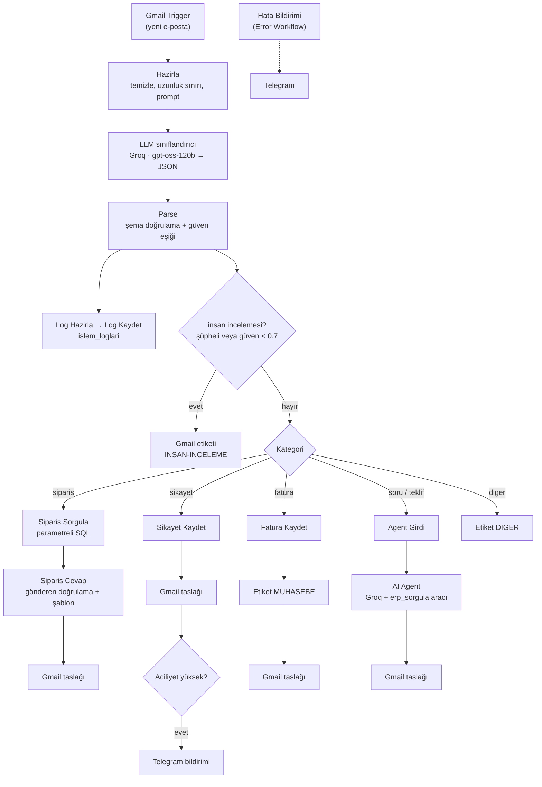

# Inbox Agent: n8n ile e-posta sınıflandıran ve taslak cevap hazırlayan AI otomasyonu

Gelen e-postaları okuyan, bir LLM ile sınıflandıran, kategoriye göre farklı iş akışlarına yönlendiren ve **hiçbir şeyi kendi başına göndermeden** insanın onaylayacağı **taslaklar** hazırlayan bir otomasyon. Bir şirketin satış/müşteri hizmetleri gelen kutusunu simüle eder. Tüm firmalar, kişiler ve siparişler **uydurmadır**.

**Neden yaptım?** Manuel e-posta ayıklama, sipariş durumu sorma ve fatura/şikayet yönlendirme gibi tekrarlayan işleri otomatikleştirirken güvenlik ve doğruluğu da ölçmek istedim. Bu yüzden projenin yarısı akışın kendisi, yarısı da onu ölçen değerlendirme çalışması.

> **Durum:** Çalışan bir prototip. Gerçek müşteri verisiyle değil, sentetik veriyle denenmiştir. Bilinen sınırlamalar aşağıda açıkça listelenmiştir.

## Ne yapar?

| E-posta türü | Otomasyonun yaptığı |
|---|---|
| **Sipariş durumu** | E-postadaki sipariş numarasını veritabanında arar, **gönderenin siparişin sahibi olduğunu doğrular**, durumu şablondan hazırladığı bir cevapla Gmail'de taslak olarak bırakır |
| **Şikayet** | Kaydeder, "şikayetiniz alındı" taslağı hazırlar, aciliyet yüksekse **Telegram ile anında bildirir** |
| **Fatura** | Kaydeder, e-postaya `MUHASEBE` etiketi koyar, nötr bir taslak hazırlar |
| **Soru / teklif talebi** | **AI Agent** ürün, stok ve SSS verisini kendi yazdığı SQL ile sorgular, fiyat ve stok içeren taslak hazırlar |
| **Reklam / spam / bildirim** | `DIGER` etiketi koyar |
| **Şüpheli veya düşük güvenli** | Hiçbir işlem yapmaz, `INSAN-INCELEME` etiketi koyar |

Her e-posta için `islem_loglari` tablosuna bir kayıt düşer. Bir node çökerse ayrı bir **Error Workflow** Telegram'dan haber verir.

## Mimari



## Tasarım kararları

- **İnsan onayı (human-in-the-loop):** Otomasyon hiçbir e-postayı göndermez, yalnızca Gmail'de *taslak* oluşturur.
- **Kritik bilgi şablondan gelir, LLM'den değil:** Sipariş durumu ve kargo takip numarası gibi doğruluğu önemli cevaplar kodla, veritabanındaki değerden üretilir. Model bu cevaplara hiç dokunmaz, uydurma riski yoktur.
- **Gönderen doğrulaması:** Sipariş bilgisi yalnızca gönderenin e-posta adresi siparişin sahibi müşterinin kayıtlı adresiyle eşleşirse verilir. "Sipariş yok" ve "sipariş sizin değil" durumlarına **aynı cevap** verilir, böylece numara deneyerek hangi siparişlerin var olduğu öğrenilemez (enumeration).
- **Parametreli SQL:** E-posta içeriği güvenilmez veri olduğu için sipariş numarası SQL'e hiç yapıştırılmaz, parametre olarak geçilir. Ayrıca LLM'in çıkardığı numara, kullanılmadan önce `SIP-1234` biçimine uyup uymadığıyla doğrulanır.
- **En az yetki:** Agent'ın SQL aracı `agent_readonly` kullanıcısıyla bağlanır: yalnızca `SELECT`, yalnızca `urunler`, `stok`, `sss` tabloları, sorgu başına 5 saniye zaman aşımı, en fazla 3 bağlantı. Müşteri ve sipariş tablolarına veritabanı seviyesinde erişemez.
- **Prompt injection savunması iki katmanlı:** (1) E-posta metni `<email>` etiketleri arasında "veri" olarak verilir, sınıflandırıcı talimat içerenleri `supheli` işaretler ve e-posta insan incelemesine düşer. (2) Bu atlatılsa bile agent'ın veritabanı yetkisi kısıtlıdır.
- **Güvenli varsayılanlar:** Model geçersiz JSON üretirse veya bilinmeyen bir kategori uydurursa e-posta kaybolmaz, `insan_inceleme: true` ile işaretlenir.
- **Idempotency:** Şikayet, fatura ve log tablolarında `mail_id` benzersizdir; aynı e-posta iki kez işlenirse kayıt çoğalmaz.
- **Sağlayıcıdan bağımsız:** Önce Anthropic Claude API ile kuruldu, sonra ücretsiz katman için Groq'a geçildi. Geçiş yalnızca istek hazırlama ve cevap ayrıştırma node'larındaki birkaç satırı etkiledi, iş mantığı değişmedi.

## Teknolojiler

n8n (Docker) · Groq API (`openai/gpt-oss-120b`) · PostgreSQL 16 · Gmail API (OAuth2) · Telegram Bot API · Python 3 (değerlendirme, yalnızca standart kütüphane) · Docker Compose

## Kurulum

Gereken: Docker Desktop, bir Gmail test hesabı (kişisel hesabınızı kullanmayın), Groq API anahtarı, Telegram botu.

```bash
git clone https://github.com/tunacolk/inbox-agent.git
cd inbox-agent
cp .env.example .env        # değerleri doldurun
docker compose up -d
```

1. `http://localhost:5678` adresinde n8n'de owner hesabı oluşturun.
2. **Credentials** bölümünde şunları tanımlayın: `Gmail Test` (Gmail OAuth2), `Groq API` (Header Auth: `Authorization: Bearer gsk_...`), `Groq` (Groq API anahtarı, agent'ın model node'u için), `ERP Postgres` (host `erp-db`, kullanıcı `erp_admin`), `ERP Agent` (host `erp-db`, kullanıcı `agent_readonly`), `Telegram Bot`.
3. Gmail'de test hesabına şu etiketleri oluşturun: `INSAN-INCELEME`, `MUHASEBE`, `DIGER`.
4. `workflows/` klasöründeki iki workflow'u n8n'e içe aktarın (`inbox_agent.json`, `hata_bildirimi.json`), credential'ları eşleştirin, Telegram Chat ID'nizi girin, `Inbox Agent` ayarlarında Error Workflow olarak `Hata Bildirimi`'ni seçin ve ikisini de yayınlayın.

Gmail OAuth bağlantısı "Testing" modunda yaklaşık 7 günde bir yenilenmelidir.

Veritabanı şeması ve sahte ERP verisi `db/init/` içindeki dosyalarla ilk başlatmada otomatik kurulur.

## Değerlendirme

Sınıflandırıcıyı etiketli iki e-posta seti üzerinde ölçtüm:

- **Geliştirme seti:** 49 e-posta, 7'si prompt injection (`data/test_emails.json`). Prompt bu set üzerinde iyileştirildi.
- **Bağımsız (holdout) set:** 27 e-posta, 9'u injection (`data/test_emails_holdout.json`). Prompt iyileştirildikten **sonra** yazıldı ve **tek bir kez** ölçüldü, sonuçlara bakılarak prompt değiştirilmedi.

| | Geliştirme (v1 prompt) | Geliştirme (v2 prompt) | **Holdout (v2 prompt)** |
|---|---|---|---|
| Kategori doğruluğu | 47/49 (%95,9) | 49/49 (%100) | **25/27 (%92,6)** |
| Prompt injection yakalama | 3/7 | 7/7 | **8/9** |
| Kategoriyi kandırabilen saldırı (hedefli) | 0/4 | 0/4 | **0/4** |
| Normal e-postada yanlış alarm | 0/42 | 0/42 | **0/18** |
| Ortalama token / e-posta | 1070 | 1294 | 1313 |

**Yalnızca holdout sütunu bağımsız bir ölçümdür.** v2 sütunundaki %100, tuning yapılan sette ölçüldüğü için iyimserdir ve "doğruluk %100" olarak okunmamalıdır. Setler küçük olduğundan sonuçlar yaklaşık değerlerdir: holdout doğruluğu için %95 güven aralığı kabaca %77-98, injection yakalama için kabaca %57-98, yanlış alarm için üst sınır kabaca %18'dir (Wilson aralığı).

### Bulgular

- **Bir düzeltme başka bir şeyi bozdu.** Bir ürünün stok sorusunu doğru sınıflandırmak için `siparis` tanımına "sipariş numarası geçen" ifadesini ekledim; bu, sipariş numarası geçen bir gecikme şikayetini `siparis` olarak yanlış sınıflandırmaya yol açtı. Ölçüm bunu yakaladı, şikayete öncelik veren bir kural ekleyerek düzelttim.
- **Prompt injection yakalama ilk promptta zayıftı (3/7).** Kaçan dört saldırının ortak noktası, doğrudan modelin kendi çıktı alanlarını (`kategori`, `guven`, `supheli`) hedef almalarıydı. Şüpheli tanımını bu durumu açıkça kapsayacak şekilde genişlettim; geliştirme setinde yakalama 7/7'ye çıktı, bağımsız sette 8/9 olarak kaldı.
- **Güven skoru yanlışları güvenilir biçimde yakalamıyor.** Modelin yaptığı hatalar da 0.95 güvenle yapıldı. Eşik (0.7) yalnızca bilgi eksikliğinde (örneğin gövdesi boş bir e-postada, güven 0.6) devreye girdi. Bu yüzden güvenlik, güven skoruna değil taslak kuralına (insan onayı) dayanıyor.
- **Aciliyet etiketi gürültülü.** Aciliyet doğruluğu geliştirme setinde %77,6, holdout'ta %66,7. Etiketler özneldir ve prompt değişince hangi örneklerin yanlış çıktığı değişiyor, bu yüzden aciliyet üzerinde ayrıca tuning yapmadım. Aciliyet yalnızca `şikayet` + `yüksek` olduğunda Telegram bildirimi tetiklediği için pratik etkisi sınırlı.

Değerlendirmeyi kendiniz çalıştırmak için `.env` dosyasına `GROQ_API_KEY=gsk_...` ekleyin:

```bash
python eval/evaluate.py                                                  # geliştirme seti
python eval/evaluate.py --veri data/test_emails_holdout.json --ad holdout # bağımsız set
```

Rapor `eval/rapor.md` ve `eval/rapor_holdout.md` olarak yazılır. Sonuçlar önbelleklenir, kesilen bir çalışma kaldığı yerden devam eder. `eval/classifier_prompt.txt`, n8n'deki `Hazirla` node'undaki prompt ile birebir aynı olmalıdır (n8n'e yapıştırılabilir hâli `workflows/hazirla_code.js`).

## Lisans

MIT. Ayrıntılar için `LICENSE` dosyasına bakın.
